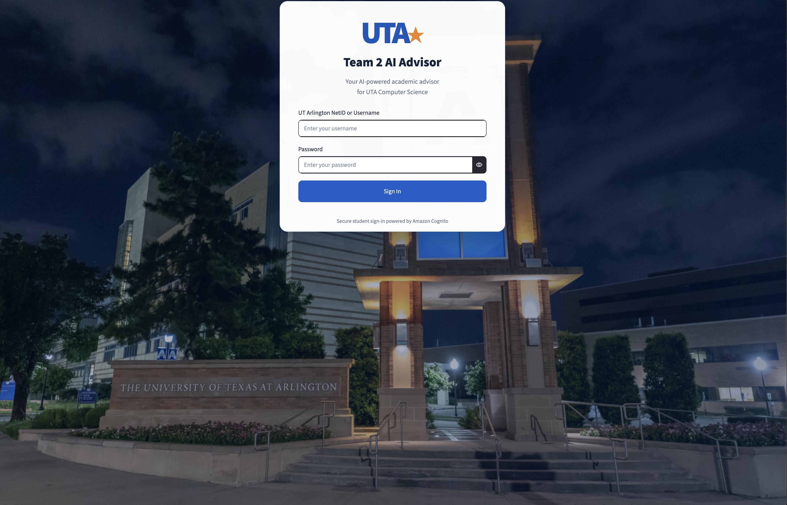
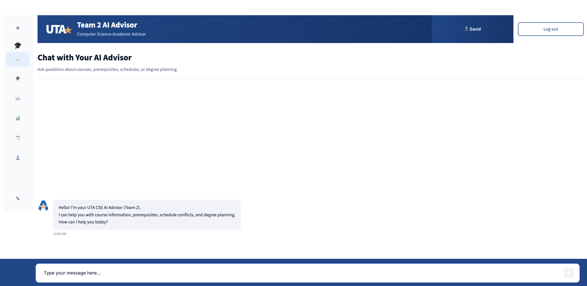

# Project 2 — UTA AI Advisor

## Overview

The **UTA AI Advisor** is an AI-powered academic advising application.

The application allows students to ask questions about:

- Course information and prerequisites
- Course eligibility
- Schedule conflicts
- Degree requirements and planning

The frontend is built using **Streamlit**, authentication is handled by **Amazon Cognito**, and student questions are processed by a **LangChain backend** powered by Amazon Bedrock.

## Application Screenshots

### Login Page — Amazon Cognito

Students must sign in using their credentials before accessing the AI Advisor.

Amazon Cognito handles authentication, while the application provides a custom login interface.




# Students

These eight fictional student accounts are used to test the AI Advisor's academic advising features.

| Student ID | Name | Username | Program | Test Scenario |
|---|---|---|---|---|
| 1002000101 | Emily Johnson | `emily1234` | BS-CS | New freshman with no completed courses |
| 1002000102 | Michael Smith | `michael1234` | BS-CS | Sophomore progressing normally |
| 1002000103 | Sarah Williams | `sarah1234` | BS-CS | Junior with strong academic performance |
| 1002000104 | James Brown | `james1234` | BS-CS | Prerequisite blocked by a low grade |
| 1002000105 | Jessica Davis | `jessica1234` | BS-SE | Senior approaching graduation |
| 1002000106 | David Miller | `david1234` | BS-CS | Failed course, successful retake, and withdrawal |
| 1002000107 | Sofia Martinez | `sofia1234` | BS-SE | Changed majors from Computer Science to Software Engineering |
| 1002000108 | Daniel Taylor | `daniel1234` | BS-CS | Part-time student attending summer semesters |


### AI Advisor Chat Interface

After authentication, students can interact with the AI Advisor through the Streamlit chat interface.



## Example Questions

| Student | Question | Expected Behavior |
|---|---|---|
| Emily Johnson | "Make me a degree plan starting Spring 2027." | Generate a degree plan for a new student |
| Michael Smith | "Can I take CSE 1325 next spring?" | Check prerequisite eligibility |
| Sarah Williams | "Can I take CSE 3320 and CSE 3318 in spring?" | Check eligibility and schedule conflicts |
| James Brown | "Can I take CSE 1325?" | Identify that CSE 1320 requires a minimum grade of C |
| Jessica Davis | "What courses do I have left?" | Identify remaining graduation requirements |
| David Miller | "Can I take CSE 4303?" | Identify the missing MATH 3330 prerequisite |
| Sofia Martinez | "What if I switched back to Computer Science?" | Evaluate a potential major change |
| Daniel Taylor | "Plan two classes per semester, including summers." | Generate a part-time degree plan |

## Project Features

- Ask questions about UTA courses
- Check course prerequisites
- Check schedule conflicts
- Generate degree plans
- Retrieve academic information using RAG
- Student login using Amazon Cognito (planned)

## Technologies Used

| Technology | Purpose |
|---|---|
| Streamlit | Web application and chat interface |
| Amazon Cognito | Student authentication |
| Python | Application development |
| FastAPI | Backend REST API |
| LangChain | AI application orchestration |
| Amazon Bedrock | Large language model inference |
| Docker | Application containerization |
| Amazon EC2 | Application hosting |
| Amazon ECR | Docker image storage |
| AWS Secrets Manager | Secure Cognito application credentials |
| GitHub Actions | Automated deployment |


## Application Architecture

The Chat UI communicates with the LangChain backend using HTTP requests.

```text
Student
   |
   v
Streamlit Chat UI (EC2)
   |
   +----> Amazon Cognito
   |       Student Authentication
   |
   v
FastAPI Backend (EC2)
   |
   v
LangChain
   |
   +----> RAG / Course Information
   |
   +----> Student Data / Academic Checks
   |
   v
Amazon Bedrock
   |
   v
Response to Chat UI
```

The backend is responsible for processing questions and returning responses. Personalized student-data authorization must be enforced by the backend, not just the frontend login.

## Project Structure

```text
project2/
│
├── chat-ui/             # Streamlit frontend
│
├── langchain/           # LangChain backend
│
├── rag/                 # RAG pipeline and embeddings
│
└── README.md            # Main project documentation
```

## RAG Pipeline

Academic documents are stored in Amazon S3 and processed into vector embeddings for retrieval.

```text
Academic Documents (S3)
          |
          v
       AWS Lambda
          |
          v
   Embedding Model
          |
          v
       ChromaDB
```

When a student asks a question, LangChain retrieves relevant information from ChromaDB and sends the context to Amazon Bedrock to generate an answer.

## GitHub Deployment Pipeline

The Chat UI is automatically deployed to AWS when changes are pushed to GitHub.

```text
Developer
   |
   | git add
   | git commit
   | git push
   v
GitHub (main branch)
   |
   v
GitHub Actions
   |
   v
Build Docker Image
   |
   v
Amazon ECR
   |
   v
AWS EC2
   |
   v
Updated Application
```

## How to Push Changes

From the repository root:

```bash
git add project2/
git commit -m "Update Project 2"
git push origin main
```

Only stage files you intend to commit. Do not include `.venv/`, `.env`, or installed dependencies.

## Run Chat UI Locally

Navigate to the Chat UI directory:

```bash
cd project2/chat-ui
```

Activate your virtual environment:

```bash
source .venv/bin/activate
```

Connect to the deployed LangChain backend.

Start Streamlit:

```bash
streamlit run app.py
```

Open http://localhost:8501 in your browser.

**Important:** The local Chat UI connects to the AWS backend. Questions may trigger Amazon Bedrock API calls and consume billable tokens.

## Project Components

### Chat UI

Provides the student-facing interface for asking questions and viewing AI responses.

See [Chat UI README](chat-ui/README.md).

### LangChain Backend

Handles student requests, routes questions, retrieves relevant data, and communicates with Amazon Bedrock.

### RAG Pipeline

Processes academic documents, creates vector embeddings, and stores them in ChromaDB for retrieval.

### Amazon Bedrock

Hosts the generative LLM used to produce final answers from the student's question and retrieved information.

## Important Notes

- The Chat UI and LangChain backend run as separate applications.
- ChromaDB is designed to run separately from the application servers.
- GitHub Actions automates the Chat UI deployment.
- Never commit virtual environments, credentials, or secrets.
- Amazon Bedrock usage can generate token-based charges.
- Degree planning and other academic checks require the appropriate backend data and logic.

## Team

**UTA CSE — Team 2**

University of Texas at Arlington


