# Team Assignment 3: A Multi-Agent System for Testing and Refactoring

This guide shows how to set up a Python virtual environment with **uv**, install the project's libraries from `app/requirements.txt`, and run the app from `app/main.py`.

## 1. Install uv

**macOS / Linux**
```bash
curl -LsSf https://astral.sh/uv/install.sh | sh
```
or with Homebrew:
```bash
brew install uv
```

**Windows (PowerShell)**
```powershell
powershell -ExecutionPolicy ByPass -c "irm https://astral.sh/uv/install.ps1 | iex"
```

Restart your terminal, then check that it worked:
```bash
uv --version
```

## 2. Create the virtual environment

From the **project root folder** (the folder that contains `app/requirements.txt` and `app/`):

```bash
uv venv
```

This creates a `.venv/` folder. To use a specific Python version:
```bash
uv venv --python 3.12
```

## 3. Activate the virtual environment

**macOS / Linux**
```bash
source .venv/bin/activate
```

**Windows (PowerShell)**
```powershell
.venv\Scripts\Activate.ps1
```

**Windows (Command Prompt)**
```cmd
.venv\Scripts\activate.bat
```

Your terminal prompt should now start with `(.venv)`.

## 4. Install the libraries

```bash
uv pip install -r app/requirements.txt
```


## 5. Configure AWS Credentials


```bash
aws configure
```

Enter your AWS credentials when prompted:

```text
AWS Access Key ID: YOUR_ACCESS_KEY
AWS Secret Access Key: YOUR_SECRET_KEY
Default region name: us-east-1
Default output format: json
```

## 6. Verify AWS Connection

Run:

```bash
aws sts get-caller-identity
```

Expected output:

```json
{
    "UserId": "AIDAEXAMPLE",
    "Account": "123456789012",
    "Arn": "arn:aws:iam::123456789012:user/tam2Admin"
}
```

**Note:** Never commit your AWS access keys to GitHub.


## 7. Run the app

From the **project root** (not from inside `app/`):

```bash
python app/main.py
```

If `main.py` imports other modules from the `app` package (for example `from app.agents import ...`), run it as a module instead:
```bash
python -m app.main
```

You can also skip activating the environment and let uv run it for you:
```bash
uv run python app/main.py
```


## 8. Development and Testing Commands

Run all commands from the `project3/` root directory.

### Prerequisites

- Python with the dependencies from `app/requirements.txt`
- JDK 17 or newer
- Apache Maven installed and available on PATH
- AWS Bedrock credentials for the AI workflow

These commands are designed for macOS/Linux shells.
On Windows, use WSL or a compatible Unix environment.

### Available Commands

| Command | Description |
|---|---|
| `make help` | Display available commands |
| `make run` | Run the full LangGraph workflow with both human reviews, automatically building the merger JAR if needed |
| `AUTO_APPROVE=1 make run` | Same workflow with the human reviews skipped. For development testing only |
| `make auto` | Short form of `AUTO_APPROVE=1 make run` |
| `make ui` | Optional terminal dashboard: menu, live workflow graph, human reviews on screen. Runs the same workflow as `make run`. See [9. Terminal Dashboard](#9-terminal-dashboard-optional) |
| `make test-original` | Copy the latest generated tests into the original Java project and run JUnit/JaCoCo |
| `make test-original-current` | Rerun installed original tests without generating or copying new ones |
| `make test-refactored` | Execute the installed adapted tests against the refactored Java implementation |
| `make verify-original` | Strict Maven verification requiring passing tests and 100% branch coverage |
| `make verify-refactored` | Strict Maven verification for the refactored implementation |
| `make test-python` | Run Python unit tests without invoking an LLM or Maven |
| `make check` | Validate Python syntax |
| `make build-merger` | Force a clean rebuild of the Java JUnit merger |
| `make clean` | Remove Java testing build outputs while retaining the merger JAR |
| `make clean-all` | Clean all three Maven projects, including the merger |

### Standard Workflow

Generate and execute a new suite:

```bash
make run
```

The workflow runs both phases of the assignment in one command:

1. Generate EP and BVA tests in parallel. An AI reviewer checks each set.
2. Merge the two sets into one JUnit class.
3. **Human review 1:** a person approves the merged tests or requests changes.
4. Run the tests on the original code and measure branch coverage.
5. Save the original-phase evidence, then refactor to the State pattern.
6. **Human review 2:** a person approves the refactored code or requests changes.
7. Run the adapted tests on the refactored code and measure branch coverage.

### Human Review (Human in the Loop)

The assignment requires a person to review the generated tests and the
refactored code. The workflow pauses at each review and waits for an answer
in the terminal:

```text
=== HUMAN REVIEW REQUIRED: review_tests (review #1) ===
Open and read: .../generated_tests/SeasonSwitchMergedTest.java (45 tests)
Approve? [y = approve / n = request changes]:
```

- Open the listed file or files and read them before answering.
- `y` approves and the workflow continues.
- `n` asks what must change. The feedback goes back to the generators
  (review 1) or to the refactor agent (review 2), and the review repeats.
- Three change requests at the same review stop the run with the status
  `review_exhausted` (tests) or `refactor_review_exhausted` (refactoring).
- Before review 1, Claude reviews the EP and BVA tests on its own. If it rejects
  them 3 times, the run does **not** stop: your review opens with a WARNING banner
  and the AI's last feedback, so check those points carefully before you approve.
- Review 1 also pauses for every **repair or gap-test proposal**. The terminal
  prints the proposed diff and the file it changes (a Java source file or the
  tests). Nothing is written or run until you answer `y`. `n` throws the
  proposal away and the agent tries again with your feedback. These rejections
  use the agent's own 3 tries, not the 3 change requests above.
- Every decision is written to the change log
  (`generated_tests/change_log_<phase>.json`).

| Review | Node | When it pauses | What to read |
|---|---|---|---|
| 1. Generated tests | `review_tests` | After `merge_tests`, before any test runs | `generated_tests/SeasonSwitchMergedTest.java` |
| 1. Repair or gap-test proposal | `review_tests` | After `repair_agent` or `generate_gap_tests`, before the change is written | The diff printed in the terminal |
| 2. Refactored code | `review_refactor` | After `refactor_agent`, before the adapted tests run | `java-refactored/src/main/java/cse4392/` and `java-refactored/src/test/java/cse4392/` |

#### Skipping the reviews while developing

Answering the prompts on every test run is slow, so development runs can skip them:

```bash
AUTO_APPROVE=1 make run
```

- The test review is recorded in the change log as `auto_approved_no_human`,
  so an automatic approval cannot be mistaken for a human one.
- The refactor review is recorded as a plain `approved`. Check the terminal
  output or the run command to tell the two apart.
- **Evidence for submission must come from a plain `make run`** with a person
  reading the files and answering both prompts.

#### How a run can end

| Status | Meaning |
|---|---|
| `refactored_saved` | Both phases finished and evidence was saved for each |
| `review_exhausted` | You (the human reviewer) requested changes to the generated tests 3 times |
| `merge_failed` | The EP and BVA classes could not be merged after the allowed retries |
| `repair_exhausted` | Tests still fail after 3 repair tries in this phase |
| `repair_blocked` | The repair agent could not run (no failure report, or an approved fix could not be written), or its last try was unusable |
| `gap_exhausted` | Coverage is still below 100% after 3 gap-test rounds in this phase |
| `gap_blocked` | The gap-test agent could not run (no JaCoCo report or missed lines), or its last try was unusable |
| `refactor_review_exhausted` | The refactoring was rejected the maximum number of times |
| `refactor_generation_failed` | The refactor agent did not return usable output |

Statuses you may see while the run is still going: `repair_pending_review`,
`gap_tests_pending_review` (waiting for your review), `code_repaired` (an
approved code fix was written), and `repair_retry` / `gap_retry` (the AI's reply
was unusable and is being retried with the error).

#### Repair and gap-test loop

| Step | What happens |
|---|---|
| Tests fail (either phase) | `repair_agent` proposes one change to a Java source file or to the tests |
| You review it | `review_tests` shows the diff; `y` writes and reruns it, `n` asks for another proposal |
| Coverage below 100% | `generate_gap_tests` proposes new `COVERAGE` test methods for the exact missed lines |
| Limits | 3 repair tries and 3 gap-test rounds per phase; an unusable AI reply counts as a try |
| Record | Every proposal, AI error, decision and rerun result goes into `repair_log` in `generated_tests/change_log_<phase>.json` |

`main()` calls `System.exit`, so gap tests reach it through
`app/java_helpers/ExitTrap.java`. It runs `main()` in a separate Java process
with JaCoCo attached. `run_tests` copies it into the phase's test folder before
every Maven run; edit the file in `app/java_helpers/`, not the copy.

To independently execute the latest generated suite
and display JUnit results and JaCoCo branch coverage:

```bash
make test-original
```

This command copies:

`generated_tests/SeasonSwitchMergedTest.java`

into:

`java-original/src/test/java/cse4392/`

WARNING: This overwrites the previously installed
merged test file. Preserve any manual changes first.

### Repeating Tests Without Regeneration

To run the same installed test suite again:

```bash
make test-original-current
```

This does not call the LLM, regenerate tests, or copy
new test source files.

It does perform a fresh Maven build.

### Strict Acceptance Verification

For original Java code:

```bash
make verify-original
```

For refactored Java code, after the State-pattern
implementation and adapted tests are available:

```bash
make verify-refactored
```

These commands use Maven's strict verification gate.
A build fails when tests fail or the required 100%
branch coverage is not achieved.


**Difference between testing and verification:**

- `make test-original` copies the latest AI-generated merged test suite into the original Java project, then runs that test class and reports JUnit results and JaCoCo branch coverage.
- `make test-original-current` reruns the previously installed merged test suite without copying or regenerating tests.
- `make verify-original` executes Maven's full verification lifecycle, including all discovered JUnit tests (such as `SeasonSwitchSmokeTest`), rather than only the AI-generated merged test class. This is the strict acceptance check for passing tests and the required 100% branch coverage.
- `make verify-refactored` performs the equivalent strict verification against the refactored Java project once that implementation is available.

Use `make test-original` to inspect the latest AI-generated tests. Use `make verify-original` to determine whether the complete original Java project satisfies its Maven verification requirements.


### Python Development Checks

Run these after modifying Python source:

```bash
make check
make test-python
```

They do not require AWS Bedrock or Maven execution.

### Maven Cleaning

The Python Java testing tool already runs Maven with:

`clean verify`

Therefore, `make test-original`,
`make test-original-current`, and
`make test-refactored` automatically remove old Maven
build outputs before testing.

Manual cleanup is available:

```bash
make clean
```

This cleans original/refactored Maven build directories
without removing Marvin's merger JAR.

For a complete Maven build reset:

```bash
make clean-all
```

The next `make run` automatically rebuilds the missing
merger JAR.

WARNING: Cleaning deletes existing Maven reports under
each project's `target/` directory. Save any evidence
required for submission before cleaning.

### Test Results and Coverage Reports

JUnit/Surefire reports:

`java-original/target/surefire-reports/`

JaCoCo HTML coverage report:

`java-original/target/site/jacoco/index.html`

The refactored project uses corresponding paths under
`java-refactored/`.

The Java testing commands report test failures and
branch coverage separately.

A nonzero exit status may indicate failed tests,
incomplete coverage, or a build problem.

### Current Implementation Status

The Makefile provides consistent commands for the
workflow currently implemented.

Implemented and wired into the workflow:

- Both human review stages (generated tests and refactored code).
- State-pattern refactoring, test adaptation, and the refactored test run.
- Recovery from a failed EP/BVA merge.
- The repair agent and gap-test generation, with human review of every change
  (see "Repair and gap-test loop" above and `docs/person4-repair-coverage.md`).
- Full-program coverage in both phases: every class and `main()`
  (see `docs/coverage-scope.md`).
- An optional terminal dashboard, `make ui`
  (see "9. Terminal Dashboard (optional)" below).

Still needed:

- A full `make run` with real human reviews to confirm both phases reach
  100% branch coverage.

Running `make run` does not by itself establish
completion of the professor's requirements.


## 9. Terminal Dashboard (optional)

`make ui` opens a full-screen dashboard in the terminal. It runs the **same
LangGraph workflow** as `make run`: same agents, same human reviews, same log
files, same evidence folders. It only changes how you watch the run and how you
answer the reviews.

| Command | What you get |
|---|---|
| `make ui` | The dashboard (this section) |
| `make run` | The plain run: log lines and `y`/`n` prompts, no dashboard |
| `make auto` | The plain run with `AUTO_APPROVE=1` (testing only), no dashboard |

The dashboard is an extra. Nothing depends on it, and `make run` and
`make auto` work without it.

### Requirements

- The `rich` package. It is in `app/requirements.txt`, so
  `uv pip install -r app/requirements.txt` installs it.
- A terminal window of at least 80 columns by 20 rows. A smaller window shows
  a "make the window larger" notice until you resize it.
- If `rich` is missing, or the output is not a terminal (a pipe, CI), the
  plain command runs instead.

### Keys that work everywhere

| Key | What it does |
|---|---|
| `Esc` | Go back one page. Every page also shows a **◀ Back** button at the top |
| `↑` `↓` | Scroll the page, or move the selection on pages that have one |
| `Space` | Next page of a long screen |
| `q` | Quit. It asks first if a run is still going |
| `?` | Help for the main menu |

The keys for the current page are always listed in the bottom rows of the screen.

### About the screenshots

The pictures below were captured from the real dashboard code. To make them
repeatable without AWS, the AI replies were replayed from a recording of an
earlier run, and one test was broken on purpose so the repair screen had
something to show (`testBVADeliberateFailure`). Maven, JUnit and JaCoCo ran for
real on those tests. The numbers in the pictures describe that demonstration
run. They are **not** the team's submission evidence, which is in `artifacts/`.

### Main menu

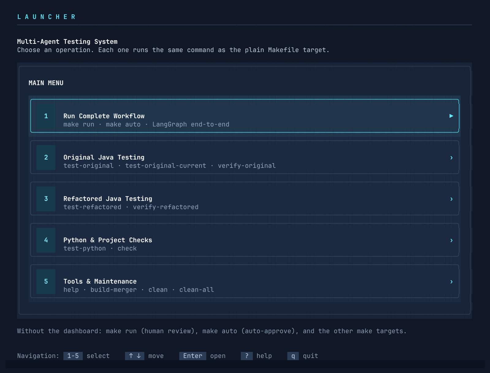

Five groups, one for each kind of Makefile target. Press `1` to `5`, or move
with the arrows and press `Enter`. Every item runs the same command as the
plain Makefile target named under it.

Press `?` for a list of what each item runs:

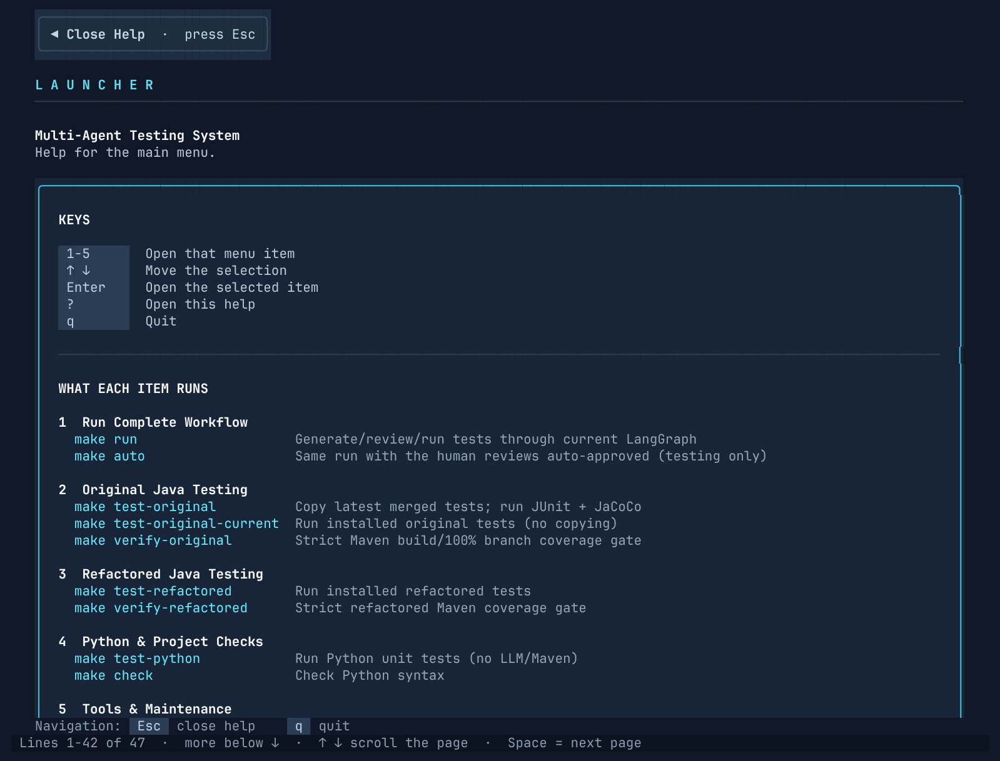

### Starting a run

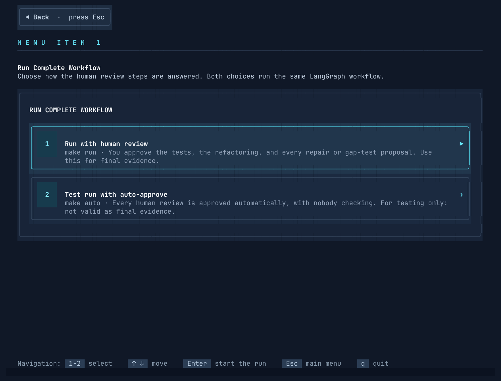

Menu item 1 asks how the human reviews are answered.

- **1 Run with human review** is the same as `make run`. Use this for final evidence.
- **2 Test run with auto-approve** is the same as `make auto`. Every review is
  approved with nobody checking. The workflow screen shows an amber
  AUTO-APPROVE banner for the whole run, and the results screen repeats it.

### Workflow screen: Overview

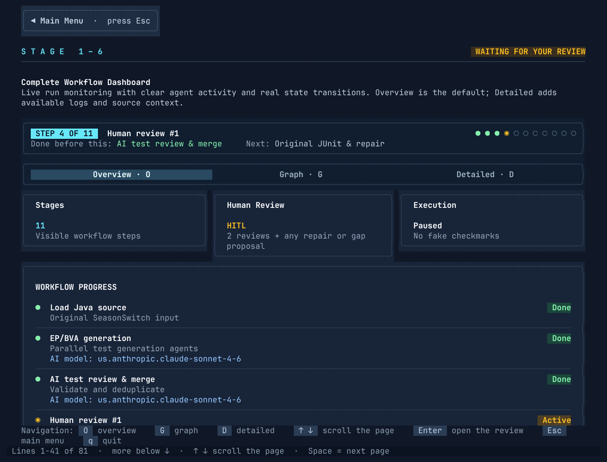

The run updates live. Press `O`, `G` or `D` to switch between the three views.

- The strip at the top shows **STEP n OF 11**, the step before, and the step after.
- **WORKFLOW PROGRESS** lists the 11 steps: Done, Active, Pending, or Stopped.
- Steps that call an AI model show which model, read from `app/main.py` when
  the run starts. Steps that need no model show nothing about models.
- When the workflow needs you, the pill at the top right says
  **WAITING FOR YOUR REVIEW**. Press `Enter` to open the review.

### Workflow screen: Graph

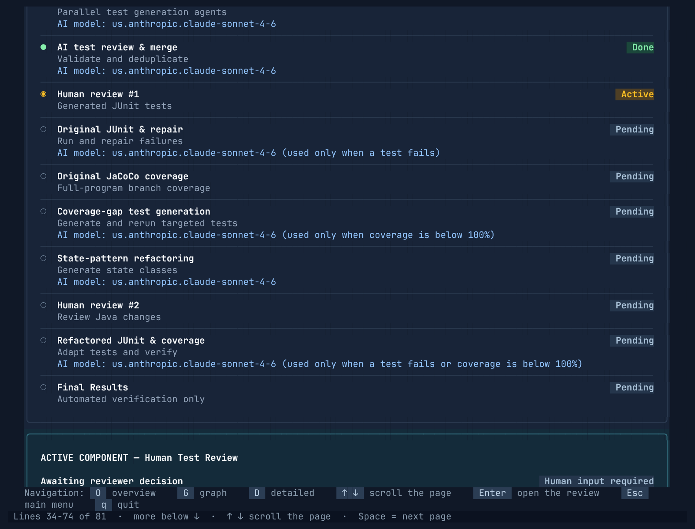

Press `G`. Each box is one LangGraph node from `build_graph()` in `app/main.py`,
in the order the nodes run.

- Amber heavy border: **RUNNING NOW**. Cyan heavy border: **NEEDS YOUR REVIEW**.
- Green: done, with a count when a node ran more than once. Grey: not reached.
- The boxes on the right are the side loops: the Repair Agent beside the JUnit
  run, and gap-test generation beside the coverage check.
- The page follows the running node by itself.

### Workflow screen: Detailed

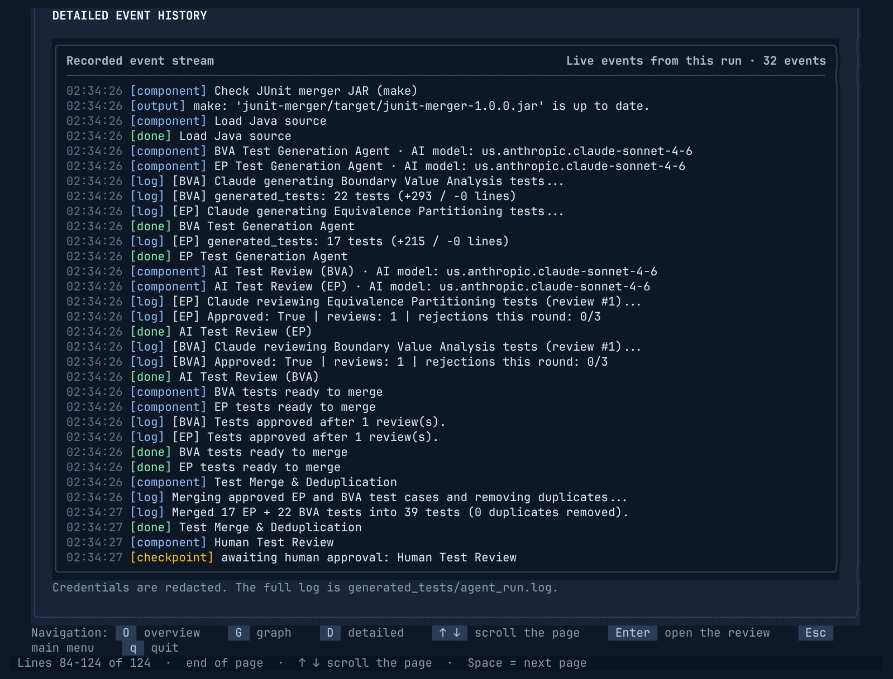

Press `D`. This adds the event history of the run: each node as it starts and
finishes, the model it calls, the workflow's log lines, and each review
decision. Credentials are redacted. The complete log is still written to
`generated_tests/agent_run.log`, as in a plain run.

### Human review 1: generated tests

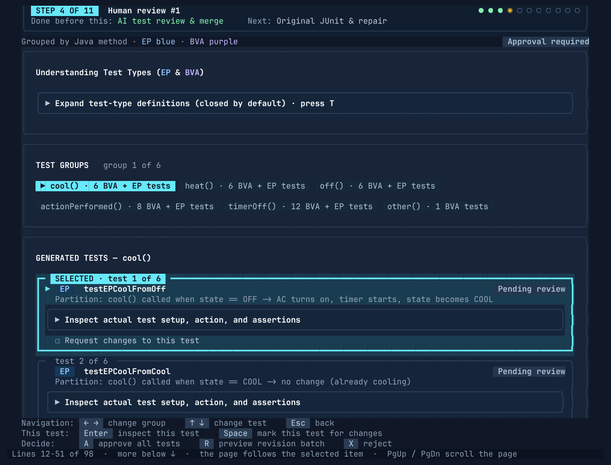

This is the `review_tests` pause. The merged tests are grouped by the Java
method they test, EP in blue and BVA in purple.

| Key | What it does |
|---|---|
| `←` `→` | Change group |
| `↑` `↓` | Change test |
| `Enter` | Show the selected test's real Java code |
| `Space` | Mark the selected test for changes, with a comment |
| `A` | Approve all tests |
| `R` | Preview the list of marked tests before sending it |
| `X` | Reject with one overall comment |

Comments are sent back by test name, so each generator is told to change only
its own marked tests. If the AI reviewer rejected a test set 3 times, a
WARNING panel at the top shows its last feedback.

### Repair proposal

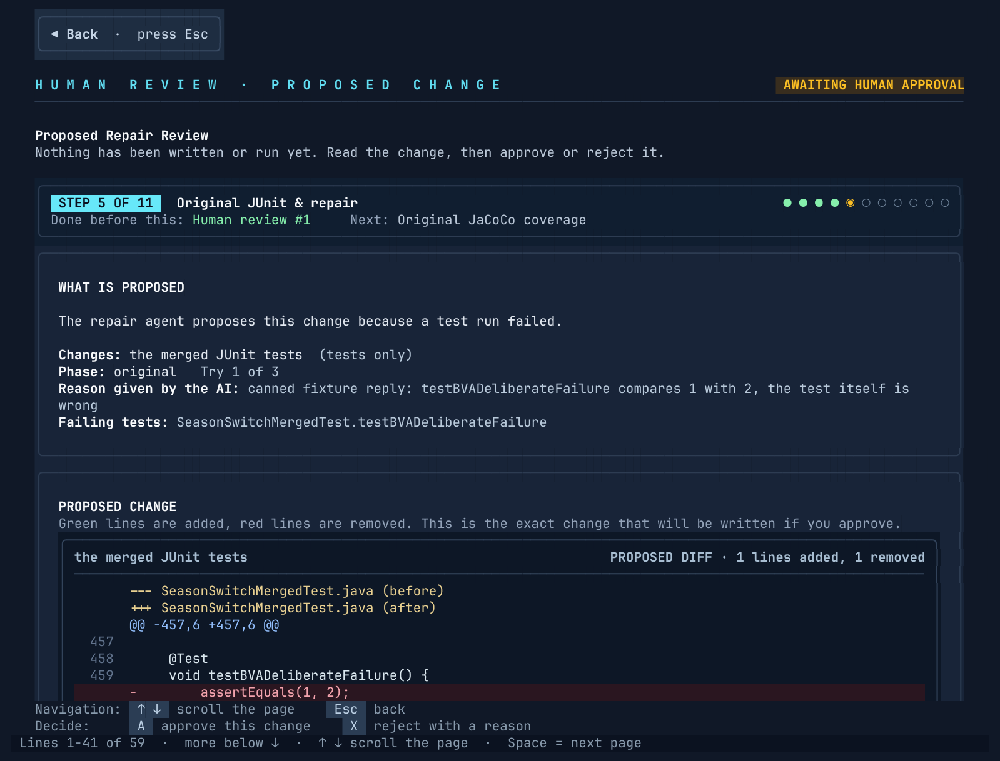

When a test fails, the Repair Agent proposes one change. This screen shows
what it wants to change, why, which tests failed, and the diff. **Nothing is
written or run until you approve.** `A` approves. `X` rejects and asks for a
reason, and the agent tries again with it.

### Coverage-gap test proposal

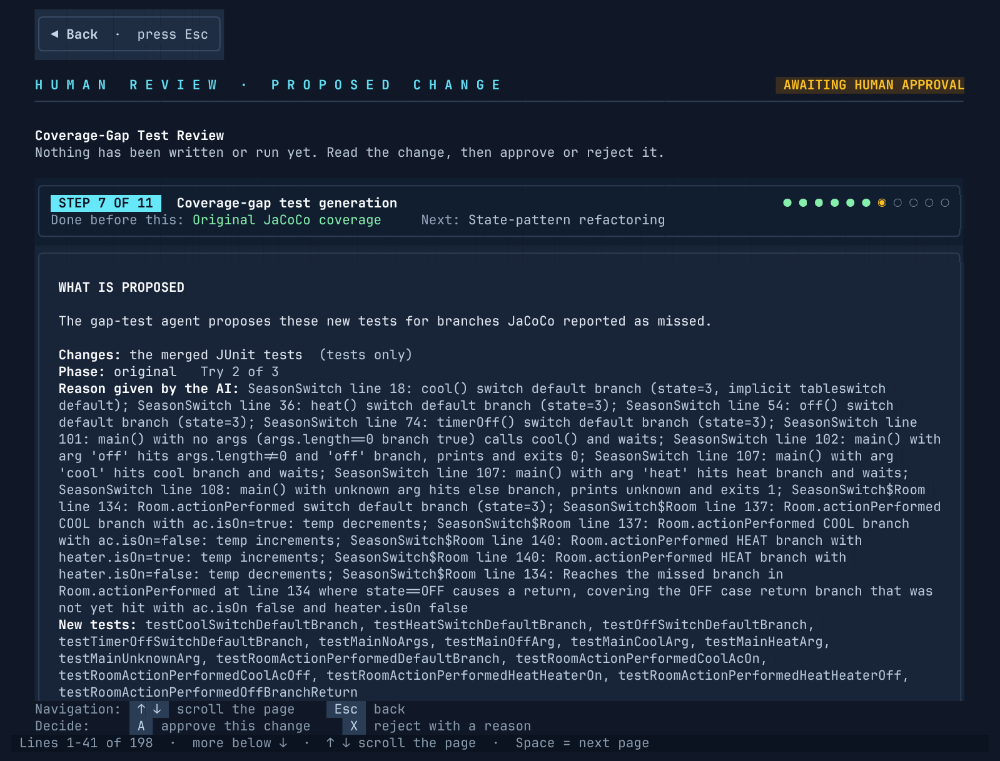

When branch coverage is below 100%, the gap-test agent proposes new tests for
the exact lines JaCoCo reported as missed. The screen works like the repair
proposal: read the diff, then `A` or `X`.

### Human review 2: refactored code

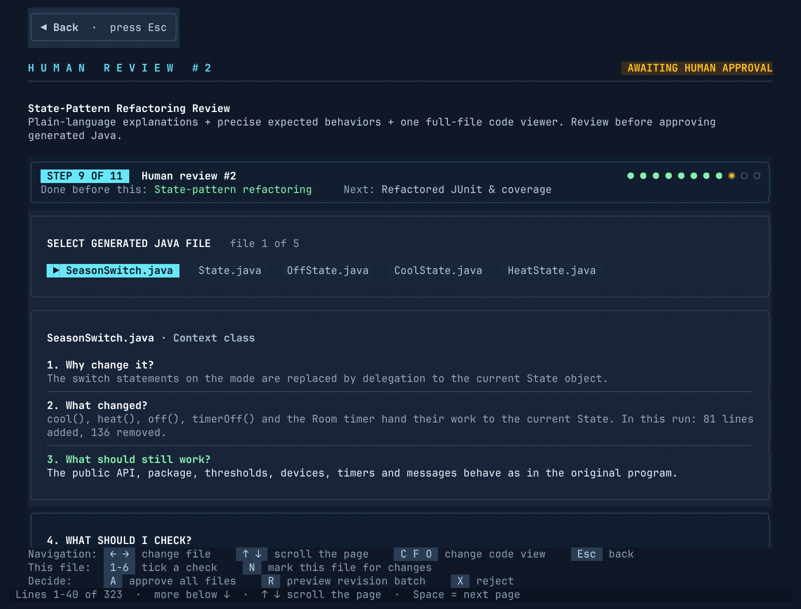

This is the `review_refactor` pause. Pick a generated Java file with `←` `→`.
For each file the page answers four questions and then shows the code.

1. Why change it?
2. What changed?
3. What should still work?
4. What should I check? Tick each check with `1` to `6`.
5. Inspect Java Implementation: the whole file. `C` shows the changes, `F` the
   refactored file, `O` the original file.

`N` marks a file for changes with a note. `A` approves all files. `X` rejects.
Notes for several files are joined into one comment for the refactoring agent.

### Results

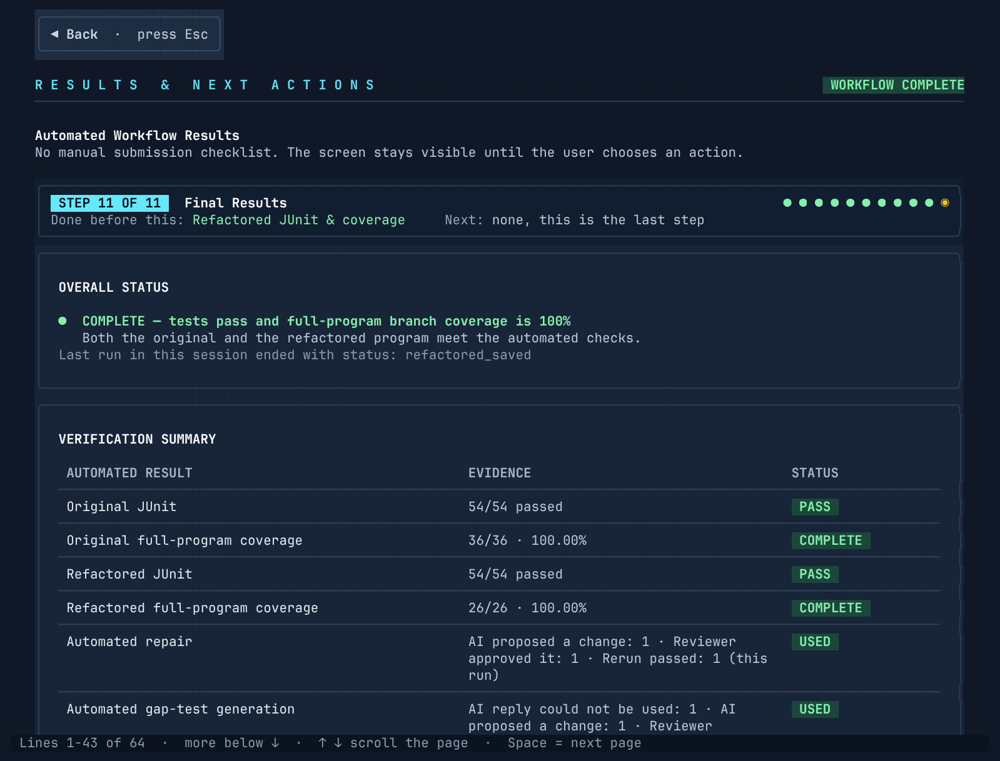

Shown when the run ends. It lists only what the automated checks found: JUnit
and full-program branch coverage for the original and the refactored program,
and how often the repair and gap-test agents were used.

- A run that stopped early says **INCOMPLETE** and names the step where it stopped.
- A report file older than this run is marked **OLD REPORT**.
- An auto-approve run says so here too.

The buttons at the end of the page: `T` test results, `C` coverage, `R` run again, `M` main menu, `Q` exit.

### JUnit and repair details

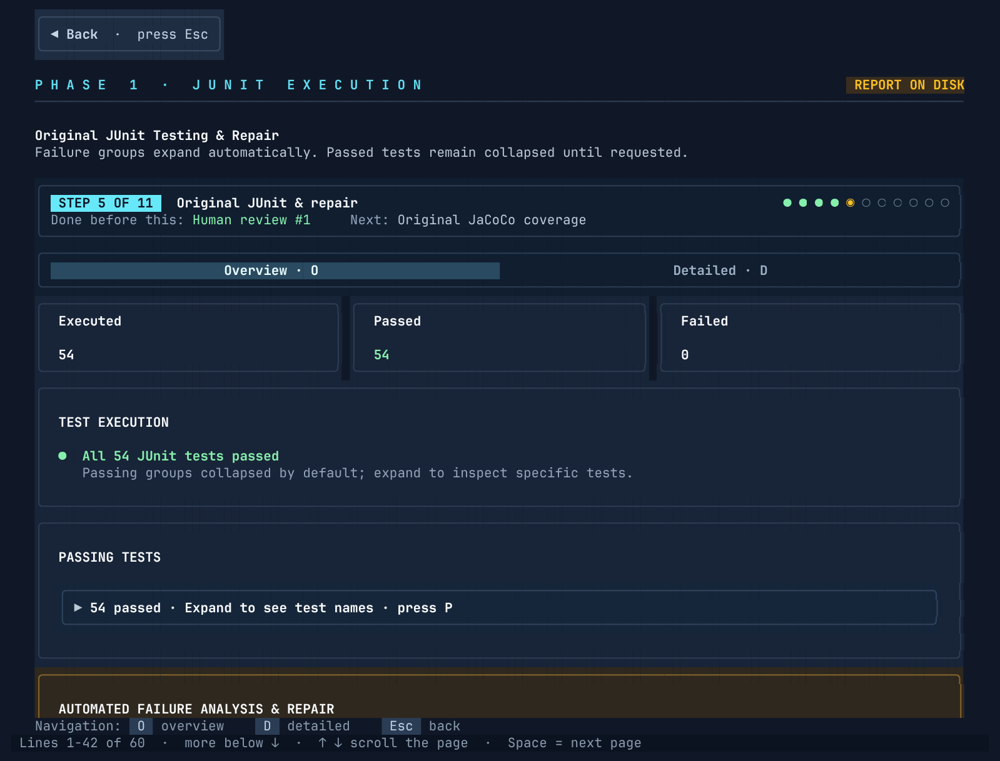

Reads the Surefire report on disk. Failed tests are expanded with their
messages. Passed tests stay collapsed until you press `P`. The repair panel
shows one card for each try of the Repair Agent, from the run's `repair_log`.

### Coverage details

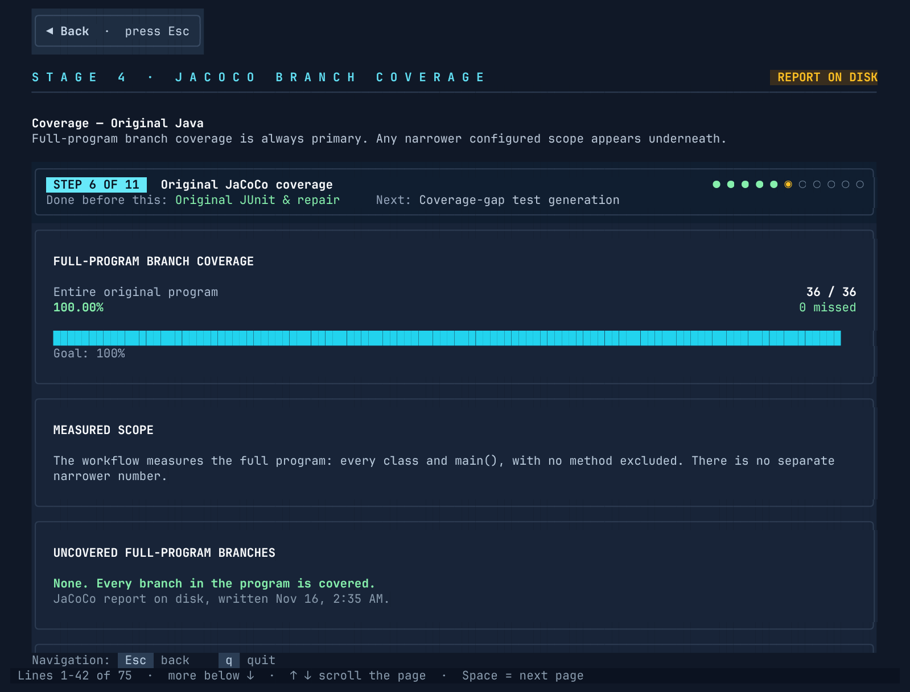

Reads the JaCoCo report on disk. The number is **full-program branch
coverage**: every class and `main()`, with nothing excluded. Missed branches
are listed by class and line, and each try of the gap-test agent is shown as
one card.

### Tools and maintenance

Menu item 5 runs `make help` and `make build-merger`, and holds the two cleanup
commands. `make clean` and `make clean-all` first list the folders they would
delete, with file counts read from disk. Nothing is deleted until you tick the
box and confirm.

### Where the dashboard code lives

| File | What it does |
|---|---|
| `app/tui.py` | Entry point for `make ui` |
| `app/ui/runner.py` | Runs the workflow on a background thread and records each step |
| `app/ui/screens.py` | Every screen |
| `app/ui/data.py` | Reads the reports and change logs from disk |
| `app/ui/term.py`, `app/ui/theme.py` | Keyboard, drawing, colors |
| `docs/repair-agent-ui-contract.md` | Which workflow fields the repair and gap panels read |
| `tests/test_ui_data.py` | Unit tests, run by `make test-python` |
